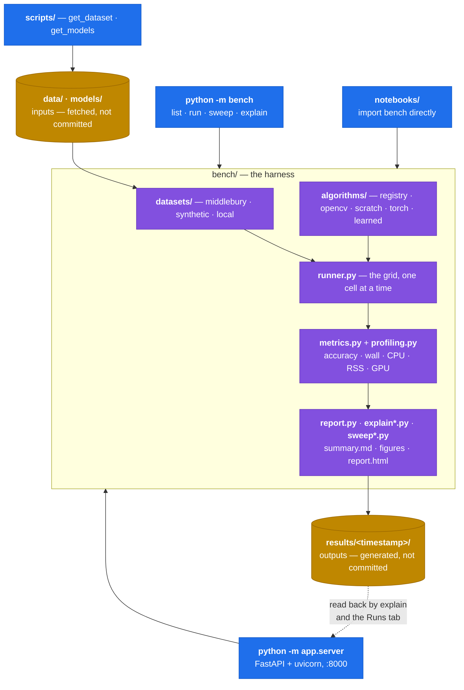
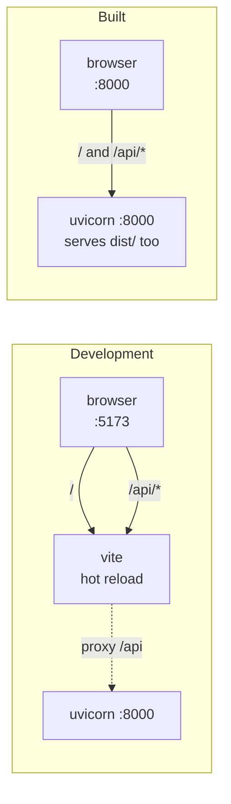
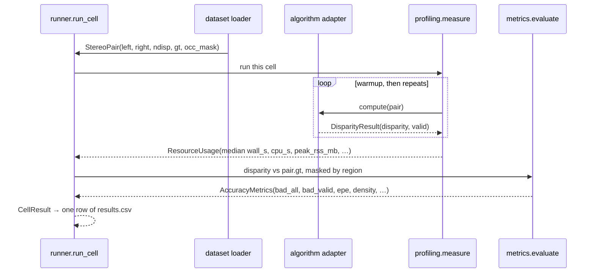

# Architecture

What the pieces are, what runs in which process, and what flows between them.

For *where files live and what is committed*, see
[repository.md](repository.md). For *what the numbers mean*, see the
[root README](../README.md).

---

## The one idea

There is one benchmark harness, the `bench` package, and everything else is a
front end onto it. The CLI and the web app do not have two implementations of
a stereo run that must be kept in agreement — the app imports `bench` and
calls the same functions, so a run triggered from the browser lands in
`results/<timestamp>/` with the same `summary.md` as `python -m bench run`.



The arrows into `runner.py` are the important ones: `bench/` has **no
dependency on `app/`**, and nothing in `bench/` knows a browser exists. That
is what makes the harness usable from a notebook and testable without a
server.

---

## What runs where

Four processes, of which you normally run one or two.

| # | Process | Command | Lifetime | Port |
|---|---|---|---|---|
| 1 | Benchmark CLI | `python -m bench run` | one shot, seconds to ~25 min | — |
| 2 | App server | `python -m app.server` | long-lived | 8000 |
| 3 | Vite dev server | `cd app/web && npm run dev` | long-lived, **dev only** | 5173 |
| 4 | Headless Chrome | spawned by `--pdf` | a few seconds | — |

### 1. The benchmark CLI — `python -m bench`

A single synchronous process that does all the work and exits. No server, no
database, no daemon.

```
bench.cli  →  datasets.resolve_pairs()     load the scenes
           →  algorithms.select()          resolve names/families/globs
           →  runner.run_benchmark()       the (scene × algorithm) grid
           →  report.write_all()           summary.md + figures/
```

`runner.py` walks the grid one cell at a time, deliberately **sequentially**:
the whole point is to measure time and CPU, and two matchers competing for the
same cores would make both numbers meaningless. A cell that fails is recorded
as a row with a non-`ok` status rather than aborting the run, so one bad
matcher cannot cost you a 25-minute sweep.

`python -m bench explain` is a second, separate invocation that reads a
finished run folder back off disk and writes `report.html` beside it. It never
re-runs a matcher — which is why it is fast, and why you can explain a run
from last week.

### 2. The app server — `python -m app.server`

`uvicorn` running the FastAPI app in `app/server/main.py`. Within this one
process:

- **The main thread** serves 19 JSON/PNG routes under `/api`, and mounts
  `app/web/dist/` at `/` when the bundle has been built.
- **Worker threads** (`app/server/jobs.py`) run batch benchmarks, one thread
  per job, with pollable progress and a cancel flag. These call the same
  `bench.runner.run_cell` the CLI does.
- **In-memory caches**, lost on restart and intentionally not persisted:

  | cache | holds | size |
  |---|---|---|
  | `compute._results` | raw disparity arrays, so re-scoring skips re-matching | 48 |
  | `catalog._cache` | loaded `StereoPair`s | 12 |
  | `jobs._jobs` | batch job records | 40 |

  The first is what makes the Playground feel live: changing the evaluation
  region or the bad-pixel threshold re-scores a **stored** array in
  milliseconds. A `result_id` that has aged out returns 404 and the UI re-runs
  it.

The server binds `127.0.0.1` and has **no authentication**, because it reads
and writes files under the repository. Do not expose it to a network.

### 3. The Vite dev server — development only

Two servers while you edit the frontend: Vite on 5173 with hot reload, FastAPI
on 8000. Vite proxies `/api` → `127.0.0.1:8000` so the browser sees one
origin. In production there is no Vite — `npm run build` writes
`app/web/dist/` and FastAPI serves it itself.



If the bundle is missing, `/` returns a JSON message telling you to build it
rather than a confusing 404.

[`.claude/launch.json`](../.claude/launch.json) starts the app server as a
named configuration. It hardcodes `.venv/Scripts/python.exe`, so it is
Windows-specific — on POSIX change that to `.venv/bin/python`, or just run
`python -m app.server` yourself.

### 4. Headless Chrome — transient

`bench explain --pdf` (and the app's **PDF** button) locates an installed
Chrome, Chromium or Edge and drives it headlessly to print `report.html` to
`report.pdf`. It is the one external binary the project shells out to, it is
optional, and its absence is reported as a clear error rather than a crash.
No browser is downloaded; nothing is installed.

---

## How one benchmark cell flows

The contract between the four stages is two dataclasses in `bench/types.py`,
and it is narrow on purpose — a matcher only has to produce an array.



Two details in that picture carry most of the project's correctness:

**`nan` means "no estimate".** `DisparityResult.disparity` is float32 in
left-image pixels, with `nan` wherever the method declined to answer. OpenCV
returns fixed-point `int16` scaled by 16 with `-16` meaning "no match", and a
naive `/16` turns every unmatched pixel into a confident `-1`, then into an
apparently-correct `0` after clipping. `base.from_opencv_fixed_point` handles
it; `metrics.evaluate` then scores those pixels as errors in `bad2_all` and
excludes them from `bad2_valid`, which is the only reason dense and sparse
methods are comparable at all.

**Timing is the median of `--repeats` runs after `--warmup` untimed ones.**
ONNX session construction and OpenCV's thread pool both initialise lazily, so
without a warmup that one-time cost lands inside the first measurement.

---

## Module map

### `bench/` — the harness

| module | responsibility |
|---|---|
| `paths.py` | every directory constant, in one place |
| `types.py` | `StereoPair`, `DisparityResult` — the two shared contracts |
| `metrics.py` | bad N, EPE, RMSE, density, hole filling |
| `profiling.py` | wall/CPU time, peak RSS at 200 Hz, GPU memory, machine info |
| `runner.py` | runs the grid; one failed cell never aborts the run |
| `report.py` | `summary.md` and the figures |
| `explain.py` | derives the findings a report states — pure, testable |
| `explain_html.py` | renders them as one self-contained page, and the PDF |
| `splits.py` | tune / held-out scene split, grouped by scene |
| `sweep.py` | parameter grids, the selection rule, the sweep runner |
| `sweep_report.py` | sweep tables and parameter-response figures |
| `cli.py` | argument parsing for `python -m bench` |
| `datasets/` | `middlebury` (+ PFM reader/writer), `synthetic`, `local` |
| `algorithms/` | `base` (registry), `opencv_classical`, `scratch`, `torch_impl`, `learned` |

`explain.py` and `explain_html.py` are split so the findings can be tested
without parsing HTML: the first returns data structures, the second turns them
into a page.

### `app/` — the explorer

| module | responsibility |
|---|---|
| `server/main.py` | FastAPI routes; mounts the built frontend |
| `server/compute.py` | single-pair runs, the result cache, cheap re-scoring |
| `server/catalog.py` | scene discovery, custom dataset upload |
| `server/params.py` | turns an adapter's dataclass into UI controls |
| `server/images.py` | PNG rendering of disparity, error and mask views |
| `server/jobs.py` | background batch runs in worker threads |
| `web/src/views/` | Playground, Compare, Runs, Datasets |

The parameter controls are **generated, not hand-written**: every adapter is a
dataclass, so its fields are its parameter list, and the sweep grids in
`bench/sweep.py` supply the ranges worth searching. Add a parameter to an
algorithm and a control for it appears in the UI with no frontend change.

---

## Extension points

Both are designed so that adding something is a registration, not an edit to
the harness.

**A new algorithm** — anything with `compute(pair) -> DisparityResult`:

```python
from .base import register

@register("my_matcher", family="scratch", description="what it does",
          tags=("local", "wta"), check=lambda: (True, ""))
def _build():
    return MyMatcher(block=7)
```

It becomes selectable by name, family, tag or glob; the parametrised contract
tests in `tests/test_algorithms.py` pick it up automatically (shape, dtype,
nan-for-invalid, determinism, and a sanity floor against a constant-disparity
baseline); and the app grows controls for its dataclass fields. Add a grid to
`GRIDS` in `bench/sweep.py` to make it tunable — tests check that every grid
key is a real parameter and that each grid brackets the shipped default.

**A new dataset** — a loader returning `StereoPair`. `datasets/local.py` is
the minimal example: any folder with `im0`/`im1` already works with no code at
all.

---

## Deliberate non-features

Worth stating, because each is a question someone will ask:

- **No database.** A run is a folder of files. `results.csv` is the interface,
  and `pandas.read_csv` is the query language.
- **No job queue or scheduler.** Batch runs are threads in the app process and
  die with it. A long run belongs on the CLI.
- **No persisted app state.** Every cache is in memory. Restarting the server
  loses nothing that cannot be recomputed.
- **No parallelism across cells.** Sequential is a measurement requirement,
  not an oversight. Use `--threads` to control parallelism *within* a matcher.
- **No GPU assumed.** `torch_*` adapters are device-agnostic and record which
  device actually ran; the development machine has no CUDA.
